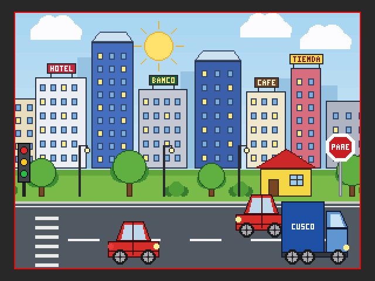
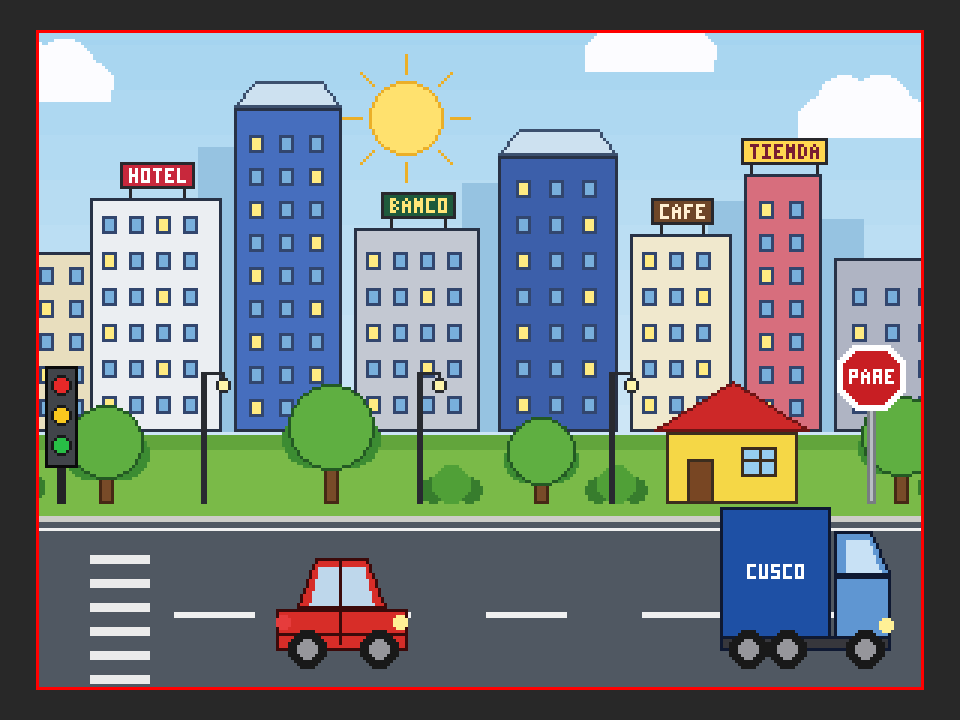
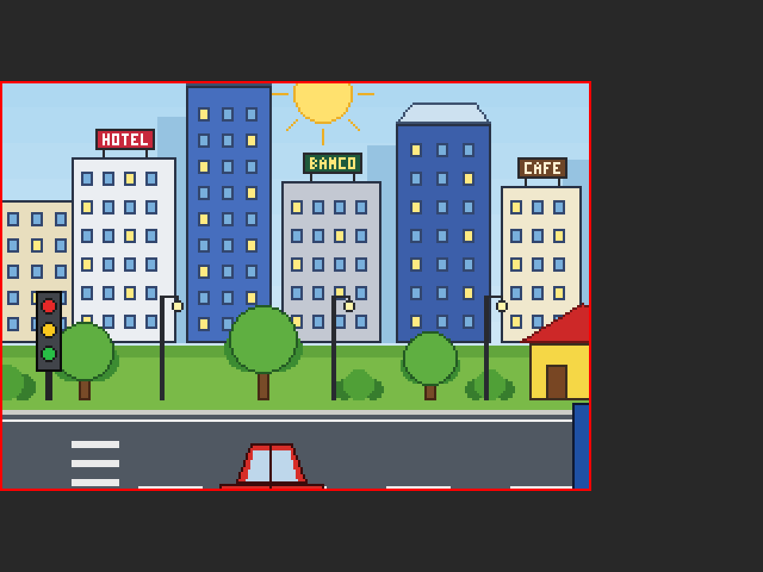
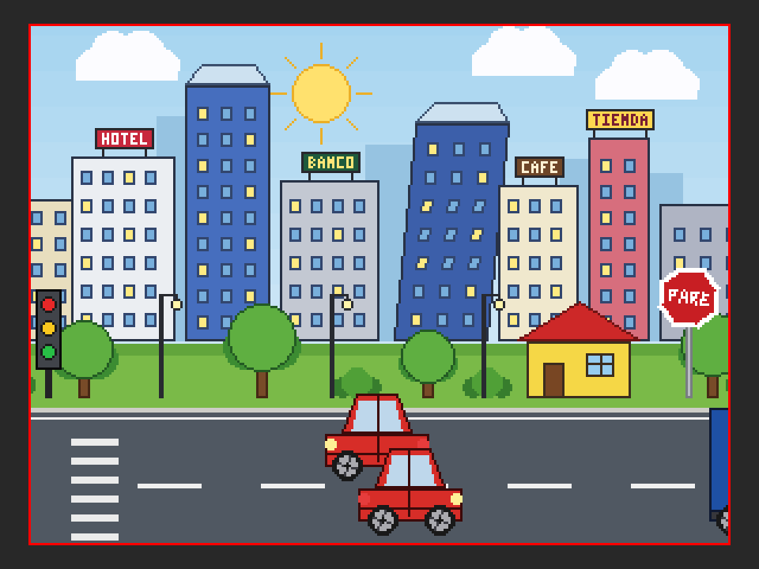

# Simulador gráfico de una escena urbana 2D

**Universidad Nacional de San Antonio Abad del Cusco**
Escuela Profesional de Ingeniería Informática y de Sistemas
Curso: Computación Gráfica I — Semestre 2026-II

| Entrega | Unidad | Contenido | Estado |
|---|---|---|---|
| Primera | I | Escena urbana 2D **estática**: primitivas, relleno y clipping | ✅ |
| Segunda | II | Escena urbana 2D **animada**: transformaciones con matrices homogéneas | ✅ |



Toda la escena se dibuja **con algoritmos propios** sobre un buffer de 320 × 240 celdas:
las líneas con **Bresenham**, las circunferencias con **punto medio**, los polígonos
se rellenan con **scan-line** y todo se recorta contra una **ventana de visualización**
con **Cohen-Sutherland** (líneas) y **Sutherland-Hodgman** (polígonos).
Los objetos se mueven con **matrices homogéneas 3×3** programadas por nosotros.
OpenGL solo se usa al final para mostrar el buffer ya calculado (`glDrawPixels`);
no se usa `glBegin(GL_LINES)`, `glTranslate`, `glRotate` ni ninguna otra función de alto nivel.

---

## 1. Integrantes y responsabilidades

| Integrante | Primera entrega | Segunda entrega |
|---|---|---|
| Keidy Sharmely Cochama Mamani | Bresenham, recorte de líneas Cohen-Sutherland, carretera | **Composición** (señal de PARE que escala y rota) |
| Lurancy Marilú Chipa Altamirano | Circunferencia por punto medio, vehículos | **Traslación** de vehículos y **rotación** de ruedas |
| Coral Bridney Wayra Cuadros Morales | Relleno scan-line, edificios y letreros | **Distorsión** (edificio inclinado) |
| José Samuel Sánchez García | Recorte de polígonos Sutherland-Hodgman, casa y árboles | **Escala** (árbol) y **reflexión** (auto reflejado) |
| David Araoz Lupinta | Estructura base, cielo, sol, nubes, semáforo, PARE, postes | Módulo de **matrices**, **bucle de animación**, traslación de **nubes** |

---

## 2. Cómo compilar y ejecutar

Requisitos: compilador C++17, CMake 3.16 o superior, GLFW 3 y OpenGL.

```bash
cmake -S . -B build
cmake --build build -j
./build/Proyecto_CG          # programa principal (en Windows: build\Debug\Proyecto_CG.exe)
./build/test_matrices        # pruebas de las matrices, sin ventana
```

### Controles

| Tecla | Acción |
|---|---|
| **1** | Activar / desactivar **traslación** (vehículos y nubes) |
| **2** | Activar / desactivar **rotación** (ruedas) |
| **3** | Activar / desactivar **escala** (árbol) |
| **4** | Mostrar / ocultar la **reflexión** (auto del carril de arriba) |
| **5** | Activar / desactivar la **distorsión** (edificio azul) |
| **6** | Activar / desactivar la **composición** (señal de PARE) |
| ESPACIO | Pausar / reanudar la animación |
| **M** | Imprimir en consola las **matrices actuales** de cada transformación |
| Flechas | Mover la ventana de visualización |
| Z / X | Achicar / agrandar la ventana de visualización |
| R | Restaurar la ventana inicial |
| V | Mostrar / ocultar el marco rojo de la ventana |
| ESC | Salir |

---

## 3. Organización del código

```
Proyecto_CG/
├── CMakeLists.txt
├── README.md
├── docs/                         capturas y animación
├── tests/
│   └── test_matrices.cpp         pruebas de las matrices con valores conocidos
└── src/
    ├── main.cpp                  ventana GLFW, teclado y BUCLE DE ANIMACIÓN
    ├── core/                     BASE
    │   ├── types.h               Color, Punto2D, Ventana
    │   ├── config.h              tamaño del lienzo y alturas de la escena
    │   ├── framebuffer.h/.cpp    ponerPixel(), limpiarBuffer(), mostrarBuffer()
    │   └── matriz.h/.cpp         MATRICES HOMOGÉNEAS 3x3 (entrega 2)
    ├── algorithms/               ALGORITMOS de la Unidad I
    │   ├── line.h/.cpp           Bresenham (8 octantes)
    │   ├── circle.h/.cpp         punto medio (contorno y disco relleno)
    │   ├── polygon.h/.cpp        relleno scan-line
    │   └── clipping.h/.cpp       ventana + Cohen-Sutherland + Sutherland-Hodgman
    └── scene/                    ESCENA
        ├── scene.h/.cpp          clase Escena: lista de piezas + matriz actual
        ├── animacion.h/.cpp      estado de la animación en el tiempo (entrega 2)
        ├── text.cpp              texto hecho con segmentos de Bresenham
        ├── objects.h             lista de funciones que arman la escena
        └── objects/
            ├── sky.cpp           cielo, ciudad lejana, sol, nubes   [traslación]
            ├── buildings.cpp     edificios y letreros               [distorsión]
            ├── road.cpp          pasto, carretera y cruce peatonal
            ├── house_trees.cpp   casa, árboles y arbustos           [escala]
            ├── signs.cpp         semáforo, PARE y postes de luz     [composición]
            └── vehicles.cpp      auto, camión y auto reflejado      [traslación, rotación, reflexión]
```

### Flujo del programa (cada frame)

```
main.cpp (bucle)
  1) dt = tiempo desde el frame anterior        (animación dependiente del tiempo, diap. 2.10)
  2) actualizarAnimacion(dt)                    posiciones, ángulos, escalas...
  3) construirEscena()                          cada objeto elige su matriz M y agrega sus piezas:
                                                cada punto se TRANSFORMA:  p' = M · p
  4) renderizarEscena()                         por cada pieza: RECORTAR -> RASTERIZAR
  5) mostrarBuffer()                            se muestra en pantalla
```

La escena se vuelve a armar en cada frame **desde las coordenadas originales** de cada objeto,
así el redondeo a píxeles no acumula errores.

---

## 4. Primera entrega — Unidad I



| Pieza | Recorte | Rasterización |
|---|---|---|
| Línea | Cohen-Sutherland | Bresenham |
| Polígono | Sutherland-Hodgman | Scan-line (+ contorno con Bresenham) |
| Círculo | Rechazo por caja envolvente + recorte por píxel | Punto medio |

### 4.2 Escenario mínimo

| Objeto | Representación en el proyecto | Algoritmos | Archivo |
|---|---|---|---|
| Carretera | Asfalto, bordes, línea central discontinua y cruce peatonal | Bresenham, scan-line | `road.cpp` |
| Edificios | Rectángulos con ventanas repetidas, techos de cristal y letreros (HOTEL, BANCO, CAFE, TIENDA) | Polígonos, scan-line, Bresenham | `buildings.cpp` |
| Casa | Rectángulo + techo triangular, puerta y ventana con cruz | Polígonos, líneas, relleno | `house_trees.cpp` |
| Árbol | Tronco rectangular + copa circular (varios círculos) | Polígono, punto medio | `house_trees.cpp` |
| Vehículo | Auto y camión con ruedas | Rectángulos, líneas y círculos | `vehicles.cpp` |
| Semáforo | Poste, caja y tres luces | Polígonos, punto medio | `signs.cpp` |
| Señal de tránsito | Octágono de PARE con texto | Polígono, scan-line, Bresenham | `signs.cpp` |
| Nubes y sol | Conjuntos de círculos; sol con rayos | Punto medio, Bresenham | `sky.cpp` |
| Postes de luz (extra) | Poste, brazo y foco | Polígono, Bresenham, punto medio | `signs.cpp` |

### 4.3 Requisitos funcionales obligatorios

| Requisito | Cómo se cumple |
|---|---|
| Al menos una línea con Bresenham | `dibujarLineaBresenham()` en `line.cpp`; todas las líneas de la escena pasan por ella |
| Tres objetos compuestos por líneas | Edificio (contornos), carretera (bordes y línea central), vehículo (franja lateral, parante, rayos de ruedas) |
| Tres circunferencias por punto medio | Ruedas, luces del semáforo, sol, nubes, copas de árbol y focos |
| Tres polígonos | Techo de la casa (triángulo), octágono de PARE, techos de cristal (trapecios), cabinas |
| Relleno scan-line en dos polígonos o más | `rellenarPoligonoScanline()` rellena todos los polígonos |
| Ventana de visualización y clipping | `g_ventana` (marco rojo) más pequeña que el lienzo; se puede mover con el teclado y la consola informa qué se recortó |
| Colores distintos por objeto | Paleta propia para cada objeto |
| Objetos en estructuras de datos | Clase `Escena` con `std::vector<ObjetoEscena>`; vehículos en vectores de `Auto` y `Camion` |



---

## 5. Segunda entrega — Unidad II: transformaciones 2D y animación



### 5.1 Convención (la del docente, Laboratorio 07)

- Puntos como **vectores columna** en coordenadas homogéneas: `p = (x, y, 1)ᵀ`, `p' = M · p`.
- Ángulo positivo = giro **antihorario**; x a la derecha, y hacia arriba.
- En una composición, **la matriz de la derecha se aplica primero**: `M = T·R·S` escala, luego rota, luego traslada.

```
T(tx,ty) = | 1 0 tx |   R(θ) = | cosθ -senθ 0 |   S(sx,sy) = | sx 0  0 |
           | 0 1 ty |          | senθ  cosθ 0 |              | 0  sy 0 |
           | 0 0 1  |          |  0     0   1 |              | 0  0  1 |

Sh_x(shx) = | 1 shx 0 |   Sh_y(shy) = | 1   0 0 |   Reflexión eje Y = S(-1, 1)
            | 0  1  0 |               | shy 1 0 |   Reflexión eje X = S( 1,-1)
            | 0  0  1 |               | 0   0 1 |
```

### 5.2 Transformaciones mínimas (tabla 5.2 del proyecto)

| # | Transformación | Objeto | Matriz | Archivo |
|---|---|---|---|---|
| 1 | **Traslación** | Auto y camión avanzan por la carretera; nubes que van y vienen (siempre completas dentro de la ventana) | `T(x, y)` · `T(dx, 0)` | `vehicles.cpp`, `sky.cpp` |
| 2 | **Rotación** | Rayos de las ruedas, respecto al **centro de cada rueda** | `M · T(c) · R(θ) · T(−c)` | `vehicles.cpp` |
| 3 | **Escala** | Árbol que crece y se achica (uniforme) respecto a la base de su tronco | `T(B) · S(s,s) · T(−B)` | `house_trees.cpp` |
| 4 | **Reflexión** | Auto del carril de arriba: es el auto rojo reflejado respecto a su línea vertical central. Se compara con el original del carril de abajo | `T(x,y) · T(22,0) · S(−1,1) · T(−22,0)` | `vehicles.cpp` |
| 5 | **Distorsión** | Edificio azul que se inclina (shear en X) sin mover su base | `T(0,96) · Sh_x(shx) · T(0,−96)` | `buildings.cpp` |
| 6 | **Composición** | Señal de PARE que **escala y rota** respecto a su centro | `T(C) · R(θ) · S(s,s) · T(−C)` | `signs.cpp` |

### 5.3 Composición: orden de multiplicación

`M = T(C) · R(θ) · S(s,s) · T(−C)` se lee **de derecha a izquierda**:

1. `T(−C)`: lleva el centro de la señal al origen.
2. `S(s,s)`: escala respecto al origen (que ahora es el centro de la señal).
3. `R(θ)`: rota respecto al origen.
4. `T(C)`: devuelve la señal a su lugar.

Si se quitara `T(−C)` y `T(C)`, la señal giraría y escalaría respecto al punto (0,0) de la pantalla
y se saldría de su lugar. Además el orden importa: `T·R ≠ R·T` (ver prueba 10 en `test_matrices`).

Lo mismo pasa con las ruedas: `Mrueda = T(x,y) · T(c) · R(θ) · T(−c)` **primero rota** los rayos
respecto al centro de la rueda y **luego los traslada** junto con el vehículo.

### 5.4 Evidencia numérica

**Tecla M** imprime en consola la matriz actual de cada transformación, con un punto de ejemplo. Por ejemplo:

```
[6] COMPOSICION - Senal PARE:  M = T(C) * R(19.97) * S(1.066) * T(-C),  C = (290, 114)
    Orden: primero T(-C), luego S, luego R, al final T(C) (la matriz de la derecha actua primero)
    Matriz resultante M:
    |    1.0021   -0.3641   40.9172 |
    |    0.3641    1.0021 -105.8343 |
    |    0.0000    0.0000    1.0000 |
    Centro (290, 114) -> (290.00, 114.00)  (punto fijo)
```

**`test_matrices`** comprueba cada matriz con valores calculados a mano:

| Prueba | Punto | Resultado esperado |
|---|---|---|
| Caso del docente `T(3,4)·R(90°)·S(2,1)` | (2, 1) | (2, 8) |
| Rotación 90° respecto a (102, 23) | (106, 23) | (102, 27) |
| Escala 1.5 respecto a (110, 72) | (110, 104) | (110, 120) |
| Reflexión respecto a x = 160 | (222, 72) | (98, 72) |
| Distorsión shx = 0.3 respecto a y = 96 | (30, 174) | (53.4, 174) |
| `T(70,20)·R(90°)` vs `R(90°)·T(70,20)` | (30, 0) | (70, 50) vs (−20, 100) |

### 5.5 Detalle técnico: círculos

El algoritmo de punto medio solo dibuja circunferencias. Por eso a un círculo se le transforma
el **centro** y su radio se multiplica por el factor de escala de la matriz, `√|det|`
(en traslación, rotación, reflexión y distorsión ese factor es 1). Para que la rotación de una
rueda **se vea**, las ruedas tienen rayos (líneas) que sí giran con la matriz.


---

## 6. Otros contenidos de la carpeta

| Carpeta | Qué es |
|---|---|
| `tools/video/` | Herramienta de la Unidad I para generar un video explicativo de la escena estática. No hace falta para compilar ni ejecutar el simulador. |
| `build/` | Carpeta de compilación local (ignorada por Git). Se puede regenerar con los comandos de la sección 2. |

Este proyecto reúne el avance de la **Unidad I** (algoritmos de rasterizado y recorte) y de la **Unidad II** (transformaciones 2D con matrices homogéneas y animación) en un solo programa.